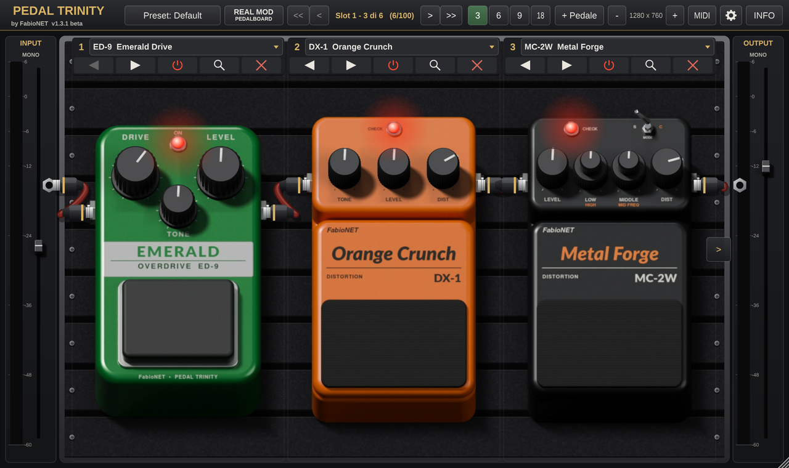

# Pedal Trinity

**Pedaliera virtuale fino a 100 pedali** con un catalogo di **864 modelli** ispirati all'intero catalogo
BOSS (compatti, Waza Craft, Twin, serie 200/500, amp e IR simulator, selettori A/B, tuner, looper), ai wah
**Cry Baby** (signature comprese, con emulazione del circuito a induttore), ai pedali di volume classici
(Dunlop, Ernie Ball, Morley, DeArmond), alle **signature MXR** (Zakk Wylde, EVH, Dimebag, Slash, Kerry King, Bonamassa, Morello, Malmsteen, Rhoads...),
all'intero catalogo **Electro-Harmonix** storico e attuale (tutte le Big Muff, Small Stone, Memory Man, POG,
HOG, Holy Grail, serie 9, Micro Synth, vocoder, wah d'epoca e molti altri) e all'intero catalogo **Ibanez** dagli anni '70
a oggi (tutte le Tube Screamer, serie 9, Master/L, Power/10, DCP, Soundtank, Tone-Lok, Mini, Tube King, wah Weeping Demon), ai pedali **Behringer** anche fuori produzione (serie in plastica,
Vintage, V-Tone, cloni moderni come Zentara, 69 Vibe, serie BM) e ai **Cuvave/M-VAVE** (Cube Baby con 9 preampli e IR, mini pedali), più **27 amplificatori** e **31 casse** fra i più usati (Fender, Vox, Marshall, Mesa/Boogie, Peavey, Soldano, ENGL, Diezel, Ampeg e altri). Interfaccia fotorealistica con pomelli 3D regolabili sull'immagine.



| | |
|---|---|
| **Versione** | 1.4.0 beta |
| **Autore** | FabioNET |
| **Licenza** | [GNU GPL v3](LICENSE) |
| **Formati** | VST3 · LV2 · Standalone |
| **Sistemi** | Linux (pacchetto `.deb`) · Windows 10/11 x64 (installer, driver **ASIO**) |
| **Framework** | C++20 · JUCE 7.0.12 · NeuralAmpModelerCore 0.5.4 |

## Funzioni

* **Fino a 100 slot** in catena; su **ogni slot** c'è il menu di scelta del pedale (per categorie).
* Slot **spostabili** a mano (trascinamento dall'intestazione o dal corpo del pedale, anche sulle celle libere)
  o con i tasti ◀ ▶, eliminabili, duplicabili; accensione dal footswitch.
* **Cavi jack** disegnati tra i pedali, dal meter INPUT al primo pedale e dall'ultimo al meter OUTPUT:
  attraversano gli slot vuoti e si sdoppiano in A/B dopo lo splitter. Sono **staccabili**: si prende una
  spina con il mouse e la si infila in un altro pedale per continuare la catena da lì (i pedali in mezzo
  vengono scavalcati), oppure la si lascia sulla pedana per staccare il pedale (il cavo si richiude da solo).
  I pedali staccati restano sulla pedaliera, con la targhetta STACCATO, e sono salvati nei preset.
* **MIDI**: una pedaliera o un controller MIDI comanda i pedali — footswitch, pomelli (anche con il pedale
  d'espressione), INPUT/OUTPUT, bypass generale, preset successivo/precedente e Program Change. Tasto **MIDI**
  nella barra per la mappatura con il tocco (tocchi un comando e muovi quello della pedaliera MIDI); elenco delle
  assegnazioni con canale, modo degli interruttori (a scatto, momentaneo, finché premuto) e gamma dei pomelli;
  dispositivi MIDI IN/OUT nello Standalone e **ritorno dello stato** sul MIDI OUT per i LED della pedaliera.
  Le assegnazioni sono salvate nel progetto.
* **Splitter SPL-3** in qualsiasi punto della catena: MONO, **DUAL** (due catene mono, A = L e B = R, su due file)
  o **STEREO** (i pedali a doppio jack elaborano A e B, un pedale mono riporta il segnale in mono come
  con i cavi veri). BALANCE e LEVEL A/B in ingresso, BALANCE / LEFT / RIGHT in uscita.
* **Opzioni** (tasto con l'ingranaggio): **18 temi** della pedaliera — Pedana Pro (alluminio a lamelle con
  tessuto a strappo, predefinito), Tolex e cromo, Noce e ottone, British Green, Alluminio spazzolato,
  Studio notte, Tolex rosso, Tweed '59, Lamiera mandorlata, Fibra di carbonio, Acero chiaro, Ebano e
  argento, Surf blu, Velluto viola, Ardesia, Guide oro, Tolex bianco, Neon notte — con pedali renderizzati
  senza sfondo e con la propria ombra. **Pedana personalizzabile**: materiale di un altro tema, colore a
  scelta o una propria immagine. Cavi visibili e **18 colori dei cavi**, compreso *Multicolore*.
  Il contrasto di testi e segni è verificato per ogni tema (WCAG 2.1).
* **Amplificatori e casse**, due categorie separate nel menu: **27 ampli** ricostruiti dallo schema vero
  (preampli a triodi, tonestack con i valori reali, riverbero a molla, tremolo, invertitore di fase, finale
  push-pull con le sue valvole, controreazione con PRESENCE/RESONANCE, trasformatore d'uscita e sag del
  raddrizzatore), calibrati con le misure pubblicate: Fender Twin/Deluxe/Princeton Reverb e Bassman, Vox AC30 e
  AC15, Hiwatt DR103, Matchless DC-30, Orange OR120, Marshall JTM45/1959/JCM800/JCM900/Jubilee, Mesa/Boogie
  Mark IIC+ e Dual Rectifier, Peavey 5150, Soldano SLO-100, Friedman BE-100, Dumble ODS, Bogner Ecstasy, ENGL
  Powerball, Diezel VH4, Roland JC-120 stereo, Ampeg SVT e B-15N, Gallien-Krueger 800RB. Nello zoom il tasto
  **Retro** mostra il pannello posteriore. **31 casse** delle stesse marche, dall'1x10 al 4x12 (e 8x10/1x15 da
  basso), più il laboratorio *Cab Lab*: fino a 12 **coni** per cassa (30 in tutto), **11 microfoni**
  (SM57, MD 421, e 906, R-121, M 160, C414, U 87...), 12 posizioni, distanza con effetto di prossimità, stanza,
  secondo microfono, LOW/HIGH CUT. La risposta è calcolata dal modello di mobile, coni e microfono.
* **Mappa di Routing** (tasto nella barra): vista d'insieme di tutta la catena con gli oggetti spostabili e i
  cavi che si staccano e riagganciano con le stesse regole della pedaliera; posizioni salvate nel progetto.
* **REAL MOD PEDALBOARD** (tasto rosso nella barra): la pedaliera si trasforma nelle **repliche fedeli
  dei pedali reali** — 860 modelli (216 BOSS, 44 wah Cry Baby, 15 pedali di volume, 16 MXR signature, 210 Electro-Harmonix, 167 Ibanez, 102 Behringer, 32 Cuvave/M-VAVE, 27 amplificatori e 31 casse) con sigla e nome veri, forma e misure ufficiali (compatti, Twin,
  serie 200/500, unità da pavimento, pedali di volume e wah a bilanciere, Rocker, box d'epoca) e comandi
  nella posizione reale; il bilanciere si trascina, i footswitch dei looper funzionano. Il suono non cambia;
  ripremendo il tasto tutto torna com'era. Si possono usare anche le **proprie foto** (cartella RealPhotos),
  appoggiate in rilievo sulla replica con i pomelli 3D allineati sopra quelli della foto (comando
  **Allinea pomelli sulla foto** nel pannello di zoom); le foto restano sul proprio computer.
  Oltre alla lista **Classica** (repliche BOSS) si possono creare **liste personalizzate**, ognuna nella
  propria cartella (`RealMod/<nome>`), con foto, allineamenti e nomi/sigle propri; si scelgono nelle Opzioni.
* **NAM-A1A2 Model** (rosso sangue, contenitore grande): lettore di modelli **Neural Amp Modeler**
  (A1, A2-Lite / A2-Full, LSTM; file `.nam` e `.namb`) con due canali **A** e **B**, ciascuno con modello
  e **IR**. Sul pedale: INPUT, BASS / MIDDLE / TREBLE (tonestack del plugin NAM), OUTPUT, volumi NAM e IR
  per canale, footswitch A e B e meter a tacche LED (IN, NAM, IR per canale). Nel pannello di zoom:
  caricamento dei file, pomello **SLIM** (attivo solo con modelli A2 slimmable), calibrazione d'ingresso
  in dBu, uscita Raw / Normalized / Calibrated, noise gate — come nel plugin NAM ufficiale.
* **Sicurezza dei file NAM**: sono accettati solo `.nam` / `.namb` il cui contenuto corrisponde
  all'estensione; ogni file è verificato prima dell'uso (struttura, versione, architettura ammessa,
  **numero esatto dei pesi** richiesto dalla rete, valori finiti, prova d'ascolto a vuoto) e i file alterati
  sono rifiutati con il motivo. Nei preset è salvata l'impronta **SHA-256**: un file cambiato dopo il
  salvataggio non viene caricato.
* **Meter INPUT e OUTPUT** laterali (mono o stereo secondo lo splitter) con fader del volume d'ingresso e d'uscita.
* **Scorrimento** a 3 pedali alla volta o a pagine (i tasti compaiono quando la catena supera la vista);
  **viste 3 / 6 / 9 / 18** pedali contemporaneamente.
* **Zoom** della finestra da 1280×760 fino a 2560×1440 (2K) e **pannello di zoom** del singolo pedale.
* **Preset**: di fabbrica e dell'utente, salva / esporta / importa (`.ptpreset`), stato salvato nel progetto DAW.
* Tasto **INFO** con licenza, autore, versione e [guida illustrata in PDF](docs/PedalTrinity_Guida.pdf).

## Emulazione

* **Pedali analogici a guadagno** (overdrive, distorsori, fuzz, metal, ampli): netlist a stadi con i valori reali
  dei componenti → funzioni di trasferimento esatte (bilineare), diodi risolti con Shockley + Newton-Raphson,
  triodi 12AX7 (Koren), stack Fender/Marshall (Yeh), sovracampionamento 4×.
* **BBD** (chorus, flanger, vibrato, Dimension, DM-2…): bucket-brigade con clock reale, filtri anti-alias, compander.
* **Digitali** (DD, RV, PS, SY…): dalle specifiche dei manuali ufficiali.
* Fonti e dati di ogni pedale: [`docs/research/`](docs/research) (schemi di fabbrica, service note, cloni, manuali).
* Il catalogo completo con affidabilità dei dati è nella guida PDF.

## Installazione

### Linux (Ubuntu 22.04+, Debian 12+, Mint 21+)
```bash
sudo apt install ./pedal-trinity_1.4.0-beta_amd64.deb
```
Installa `/usr/lib/vst3/Pedal Trinity.vst3`, `/usr/lib/lv2/Pedal Trinity.lv2` e l'app `pedal-trinity`
(nel menu *Audio*). La guida si trova in `/usr/share/doc/pedal-trinity/`.

### Windows 10/11 (x64)
Esegui `PedalTrinity-1.4.0-beta-Windows-x64-Setup.exe`. Il VST3 va in
`C:\Program Files\Common Files\VST3`, l'LV2 in `C:\Program Files\Common Files\LV2`.
L'app standalone supporta i driver **ASIO** (selezionati automaticamente al primo avvio se presenti),
WASAPI e DirectSound.

## Rami del repository

| Ramo | Contenuto |
|---|---|
| `main-linux` | sorgenti + CI Linux (build, autotest, pacchetto `.deb`, archivio `.tar.xz`) |
| `main-windows` | sorgenti + CI Windows (build MSVC con ASIO SDK, autotest, installer Inno Setup, `.zip`) |

## Compilazione dai sorgenti

Linux:
```bash
sudo apt install build-essential cmake ninja-build libasound2-dev libjack-jackd2-dev \
  libfreetype6-dev libfontconfig1-dev libx11-dev libxext-dev libxrandr-dev libxinerama-dev libxcursor-dev
cmake -B build -G Ninja -DCMAKE_BUILD_TYPE=Release     # scarica JUCE 7.0.12
cmake --build build
"build/PedalTrinity_artefacts/Release/Standalone/Pedal Trinity" --selftest
bash packaging/linux/build_deb.sh build dist
```

Windows (Visual Studio 2022):
```bat
cmake -B build -G "Visual Studio 17 2022" -A x64 -DPT_ASIO_SDK_DIR=C:\percorso\asiosdk
cmake --build build --config Release
iscc packaging\windows\PedalTrinity.iss
```
Lo [Steinberg ASIO SDK](https://www.steinberg.net/developers/) (disponibile anche con licenza GPLv3)
si scarica separatamente; la CI lo scarica automaticamente.

## Struttura

```
Source/
  engine/             motore: catena lock-free (Chain), circuiti a stadi (Circuit), famiglie DSP (Fx*.cpp),
                      catalogo generato (Catalog.inc)
  gui/                slot, vista del pedale, comandi 3D, pannelli zoom e info
  Presets.cpp         preset utente/fabbrica
  StandaloneApp.cpp   app standalone (ASIO, --selftest, --screenshot)
Resources/            render degli 864 modelli, filmstrip 3D dei comandi, licenza, guida PDF
docs/research/        dossier tecnici con le fonti di ogni pedale
docs/guide/           guida (LaTeX) generata da tools/build_guide.sh
packaging/            .deb (Linux) e installer Inno Setup (Windows)
tools/art/            catalogo dei modelli (catalog_*.py, CATALOG_SPEC.md), serigrafie, render Blender,
                      assemblaggio: servono solo per rigenerare immagini e catalogo, non per compilare
```

## Grafica

Le immagini dei pedali e i fotogrammi 3D dei comandi sono **render originali** creati con Blender
(`tools/art/render_pedals.py`), non fotografie di prodotti commerciali; nomi e sigle sui pedali sono
originali. Pipeline: `catalog.py` → `make_catalog_textures.py` → `render_pedals.py` → `assemble_catalog.py`.
Il plugin incorpora le immagini: la compilazione richiede solo un compilatore C++ e CMake.

## Marchi

Pedal Trinity è un progetto indipendente. *Ibanez*, *Tube Screamer*, *Tube King*, *Weeping Demon*, *Soundtank*, *Tone-Lok* e *Jemini* sono marchi di Hoshino Gakki Co.; *Maxon* di Nisshin Onpa; *Nutube* di Korg Inc.; *Behringer*, *V-Tone* e *Hellbabe* di Music Tribe; *Cuvave*, *M-VAVE* e *Cube Baby* di Zhuhai Sinco Intelligent Technology; *SansAmp* di Tech 21; *Klon* e *Centaur* di Klon LLC; *Moogerfooger* di Moog Music; *Line 6* di Yamaha Guitar Group; *Mu-Tron*, *Uni-Vibe*, *Tycobrahe* e *Lovetone* dei rispettivi titolari;
*BOSS*, *Roland*, *Waza Craft* e le sigle dei pedali BOSS (DS-1, MT-2, GE-7, …) sono marchi di Roland
Corporation; *Fender* di Fender Musical Instruments Corporation; *Dunlop*, *Cry Baby* e *MXR* di Dunlop
Manufacturing, Inc.; *Ernie Ball* di Ernie Ball, Inc.; *Electro-Harmonix*, *Big Muff*, *Memory Man*, *POG* e *Holy Grail* di New Sensor
Corporation; *Sovtek*, *Morley* e *DeArmond* dei rispettivi titolari.
Twin Reverb, Deluxe Reverb, Princeton e Bassman di Fender Musical Instruments; JC-120 di Roland Corporation; Vox, AC30 e AC15; Marshall, JTM45, JCM800, JCM900 e Silver Jubilee; Mesa/Boogie, Mark IIC+ e Dual Rectifier; Peavey e 5150; Soldano e SLO-100; Hiwatt, Matchless, Orange, Dumble, Friedman, Bogner, ENGL, Diezel, Ampeg, SVT, Gallien-Krueger; Celestion, Jensen, Eminence, JBL, Fane, Weber; Shure, Sennheiser, beyerdynamic, Royer, AKG, Neumann e Audio-Technica sono marchi dei rispettivi titolari (ampli, altoparlanti e microfoni citati solo come riferimento del suono).
I nomi sono citati solo per indicare il suono di riferimento (e, in REAL MOD, per identificare il pedale
replicato, senza loghi): nessuna affiliazione o approvazione. I nomi degli artisti delle versioni signature
servono solo a identificare il modello di riferimento; le repliche non ne riproducono artwork, ritratti o firme.
VST è un marchio di Steinberg Media Technologies GmbH. ASIO è un marchio e software di Steinberg Media Technologies GmbH.

## Sicurezza e privacy

* Nessuna connessione di rete, nessuna raccolta di dati o statistiche.
* Modelli NAM, IR, foto personali, preset e stati dei progetti sono verificati prima dell'uso
  (formato, dimensione, annidamento, valori finiti); i preset non possono far aprire percorsi di rete
  o file speciali di sistema.
* *Esporta su file* toglie dai preset i percorsi locali dei file (modelli NAM, IR).
* Le foto personali REAL MOD e l'immagine della pedana restano sul proprio computer; i nomi delle liste
  REAL MOD sono controllati (nessuna cartella fuori da `RealMod`), eliminare una lista la sposta nel cestino.

## Licenza

Copyright © 2026 FabioNET — distribuito secondo i termini della
**GNU General Public License v3.0** (o successiva). Vedi [LICENSE](LICENSE).

Il pedale NAM-A1A2 include componenti di terze parti con licenza MIT — NeuralAmpModelerCore,
AudioDSPTools e parti di NeuralAmpModelerPlugin (Steven Atkinson), nam-binary-loader (TONE3000),
nlohmann/json — ed Eigen (MPL 2.0): testi in [Source/third_party/LICENSE-NAM.txt](Source/third_party/LICENSE-NAM.txt).
